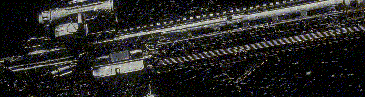
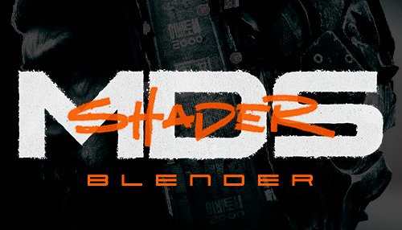
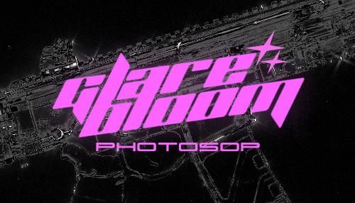

  

  <strong>ΗΞŁŁΘ</strong>

  <strong>💥ᴡᴇʟᴄᴏᴍᴇ ᴛᴏ ᴍʏ ᴘᴀɢᴇ💥</strong>

–⨯ ᴍʏ ɴᴀᴍᴇ ɪꜱ 𝑫𝒊𝒎𝒂, ᴀɴᴅ ɪ ʟᴏᴠᴇ ᴄʀᴇᴀᴛɪɴɢ ᴀʟʟ ᴋɪɴᴅꜱ ᴏꜰ ᴀʀᴛ, ᴍᴏꜱᴛʟʏ ʙᴀꜱᴇᴅ ᴏɴ ᴍʏ ꜰᴀᴠᴏʀɪᴛᴇ “𝑪𝒂𝒍𝒍 𝒐𝒇 𝑫𝒖𝒕𝒚” ɢᴀᴍᴇ ꜱᴇʀɪᴇꜱ ⨯– 
ɪ ᴀʟꜱᴏ ᴡᴏʀᴋ ᴏɴ ᴘʀᴏᴊᴇᴄᴛꜱ ᴅᴇꜱɪɢɴᴇᴅ ᴛᴏ ᴍᴀᴋᴇ ɪᴛ ᴇᴀꜱɪᴇʀ ᴛᴏ ᴡᴏʀᴋ ᴡɪᴛʜ ᴍᴏᴅᴇʟꜱ ꜰʀᴏᴍ ᴛʜᴇ “𝑪𝒂𝒍𝒍 𝒐𝒇 𝑫𝒖𝒕𝒚” ɢᴀᴍᴇꜱ

——————— ⨯ｘＸｘ⨯ ———————

❗𝔦𝔫𝔣𝔬❗

⌜ ᴄᴜʀʀᴇɴᴛʟʏ ᴡᴏʀᴋɪɴɢ ᴏɴ: ᴄᴏɴᴛᴇɴᴛ ᴀɴᴅ ᴛᴏᴏʟꜱ ꜰᴏʀ ʙʟᴇɴᴅᴇʀ ⌟​ 
⌞  ʟᴇᴀʀɴɪɴɢ: ʜᴏᴡ ᴛᴏ ᴄʀᴇᴀᴛᴇ ʙᴇᴀᴜᴛɪꜰᴜʟ ᴀʀᴛᴡᴏʀᴋ ᴀɴᴅ ᴅᴇᴠᴇʟᴏᴘ ꜱᴏꜰᴛᴡᴀʀᴇ ⌝ 
⌜ ɪ ʟᴏᴠᴇ ᴍɪʟɪᴛᴀʀʏ ᴄᴜʟᴛᴜʀᴇ ᴀɴᴅ ᴇᴠᴇʀʏᴛʜɪɴɢ ʀᴇʟᴀᴛᴇᴅ ᴛᴏ ɪᴛ ⌟ 
⌞ ᴄᴏɴᴛᴀᴄᴛ: ᴅɪꜱᴄᴏʀᴅ <b>"𝒅𝒊𝒍𝒊𝒇𝒂"</b> / ꜱᴛᴇᴀᴍ <b>"𝑴𝒙𝒓𝒂𝒚"</b> ⌝ 
⌜ ɪ ᴄᴏᴍᴘᴏꜱᴇ ᴍᴜꜱɪᴄ: “ᗪIᒪIᖴᗩ” ⌟ 
⨯ｘＸｘ⨯

  
  
  
  
  

——————— ⨯ｘＸｘ⨯ ———————

​

<strong>✨ 🇫🇪🇦🇹🇺🇷🇪🇩 🇵🇷🇴🇯🇪🇨🇹🇸 ✨</strong>

  <strong>–⨯ ᴍʏ ᴘʀᴏᴊᴇᴄᴛꜱ ⨯–</strong>

<table>
  <tr>
    <td width="50%" align="center" valign="top">
      
      <h3>MDS Shader</h3>
      
Blender addon for "CALL OF DUTY"

      

        
        
      

      
    </td>
    <td width="50%" align="center" valign="top">
      
      <h3>Glare & Bloom</h3>
      
Create bloom and glare in Photoshop

      

        
        
      

      
    </td>
  </tr>
</table>
